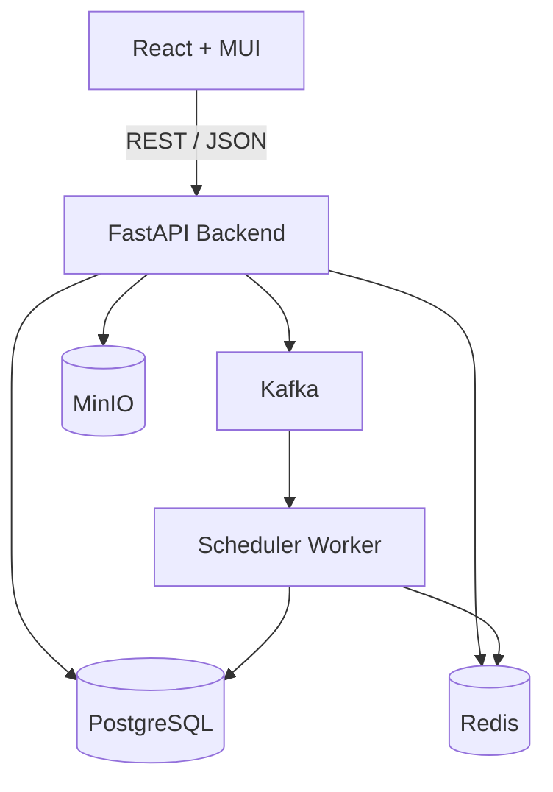

# Lessons Schedules Service

Сервис автоматического составления, проверки, редактирования и оптимизации расписания занятий на двухнедельный цикл.

## Возможности

- регистрация и авторизация пользователей;
- несколько проектов расписаний на пользователя;
- преподаватели, аудитории, группы, подгруппы и потоки;
- очные и дистанционные занятия;
- обязательные ограничения и предпочтения преподавателей;
- один оптимальный или `TOP-N` вариантов расписания;
- проверка и оптимизация существующего расписания;
- импорт и экспорт `.xlsx`, `.ods`, `.csv`, `.json`;
- хранение загруженных файлов и истории выгрузок.

## Стек

### Frontend

- React
- MUI

### Backend

- Python 3.12
- FastAPI
- SQLAlchemy

### Infrastructure

- PostgreSQL
- Redis
- Kafka
- MinIO
- Docker Compose

## Архитектура



Backend обрабатывает HTTP API и пользовательские операции.

Scheduler Worker выполняет длительные задачи построения и оптимизации расписания.

PostgreSQL является постоянным хранилищем данных. Redis используется для краткоживущего состояния расчётов и запросов на отмену. Kafka передаёт расчётные задания Worker. MinIO хранит исходные загруженные файлы и историю экспортов.

## Структура репозитория

```text
/
├── backend/
│   ├── app/
│   │   ├── api/
│   │   ├── application/
│   │   ├── bootstrap/
│   │   ├── domain/
│   │   ├── infrastructure/
│   │   ├── scheduling/
│   │   └── worker/
│   ├── tests/
│   ├── alembic/
│   ├── alembic.ini
│   └── pyproject.toml
├── frontend/
│   ├── src/
│   ├── tests/
│   └── package.json
├── docs/
│   ├── FS.md
│   └── HLD.md
├── test-data/
│   └── minimal-project.json
├── .github/
│   ├── workflows/
│   └── pull_request_template.md
├── docker-compose.yml
├── .env.example
├── .editorconfig
├── .gitignore
└── README.md
```

## Локальный запуск инфраструктуры

Создать локальный файл окружения:

```bash
cp .env.example .env
```

Запустить инфраструктуру:

```bash
docker compose up -d
```

Проверить состояние:

```bash
docker compose ps
```

На стартовом этапе Docker Compose поднимает PostgreSQL, Redis, Kafka и MinIO. Backend, Scheduler Worker и Frontend запускаются локально до появления их Dockerfile.

## Backend

Из каталога `backend`:

```bash
python -m venv .venv
source .venv/bin/activate
python -m pip install --upgrade pip
pip install -e ".[dev]"
uvicorn app.main:app --reload
```

Проверка:

```text
GET http://localhost:8000/health
```

Миграции базы (нужен PostgreSQL из `docker compose`, адрес берётся из `DATABASE_URL`):

```bash
alembic upgrade head                            # применить все миграции
alembic revision --autogenerate -m "add new models"  # создать миграцию по изменениям моделей
alembic downgrade -1                            # откатить последнюю миграцию
alembic history                                 # список миграций
```

Сгенерированную миграцию нужно прочитать перед коммитом: Alembic не распознаёт переименования и часть изменений типов. Тесты проверяют, что миграции совпадают с моделями и что каждая из них откатывается.

Проверки перед Pull Request:

```bash
ruff check .
lint-imports
pytest                       # интеграционные тесты сами поднимают PostgreSQL в Docker
pytest -m "not integration"  # быстрый прогон без Docker
```

Код бэкенда разделён на слои:

- `domain` — сущности и правила предметной области, только стандартная библиотека;
- `application` — сценарии и порты (интерфейсы того, что сценариям нужно снаружи);
- `api`, `worker`, `infrastructure` — адаптеры: HTTP, обработчик заданий, PostgreSQL, MinIO и т. д.;
- `bootstrap` — настройки и сборка приложения.

Импорт разрешён только в сторону внутренних слоёв: `domain` ничего не знает о FastAPI и SQLAlchemy. Это проверяет `lint-imports`.

## Frontend

Из каталога `frontend`:

```bash
npm install
npm run dev
```

## Git workflow

Используется схема с двумя постоянными ветками:

- `main` — стабильное состояние, пригодное для демонстрации и релиза;
- `dev` — интеграционная ветка текущей разработки.

Рабочие ветки создаются от актуальной `dev` и через Pull Request возвращаются в `dev`.

Префиксы:

```text
feature/
fix/
refactor/
infra/
docs/
hotfix/
```

Примеры:

```text
feature/auth-api
feature/project-editor
fix/room-validation
refactor/scheduler-core
infra/docker-compose
docs/api-contract
hotfix/login-crash
```

Обычный процесс:

```text
dev
 ↓
feature/* | fix/* | refactor/* | infra/* | docs/*
 ↓
Pull Request
 ↓
dev
 ↓
интеграционная проверка
 ↓
Pull Request
 ↓
main
```

Переход `dev → main` выполняется отдельным Pull Request после достижения контрольной точки.

Прямые push в `main` и `dev` запрещены. Для обеих веток должны действовать Ruleset с обязательным Pull Request, одним approval, успешными CI checks, закрытыми review comments и запретом force push.

Для обычного merge требуется:

- минимум одно одобрение другого участника;
- успешное прохождение обязательных CI checks;
- отсутствие нерешённых review comments;
- соответствие Definition of Done.

### Hotfix

Критическое исправление для кода, уже находящегося в `main`, создаётся от `main`:

```text
main → hotfix/* → main
```

После merge исправление обязательно переносится обратно в `dev` через Pull Request `main → dev`.

## Управление задачами

Единым источником состояния задач команды является **Trello**.

GitHub Project Board не используется. GitHub Issues не должны дублировать карточки Trello.

Рекомендуемые статусы:

```text
Backlog → Ready → In Progress → Review → Done
                         ↓
                      Blocked
```

Для карточки разработки указываются:

- исполнитель;
- область: Frontend / Backend / DB / Scheduler / DevOps / Docs;
- приоритет: High / Medium / Low;
- контрольная дата;
- размер: S / M / L;
- связанные требования FS;
- связанные разделы HLD;
- блокирующие зависимости при наличии.

`Review` означает, что открыт Pull Request рабочей ветки в `dev`.

`Done` означает, что задача прошла review и влита в `dev`. Переход `dev → main` является интеграционной контрольной точкой и не удерживает отдельные карточки разработчиков в работе.

В течение одной контрольной недели у участника желательно держать не более двух задач одновременно в `In Progress`.

На еженедельном созвоне команда проходит задачи в порядке:

```text
Review → Blocked → In Progress → Ready
```

## Pull Request

Шаблон PR находится в `.github/pull_request_template.md`.

Типовые направления:

```text
рабочая ветка → dev
dev → main
hotfix/* → main
main → dev после hotfix
```

В PR указываются:

- что изменено;
- связанные требования FS;
- связанные разделы HLD;
- способ проверки;
- добавленные или изменённые тесты;
- ссылка на связанную карточку Trello для рабочих задач.

## Definition of Done

Обычная задача считается завершённой, если:

- реализованы требования FS, указанные в карточке Trello;
- реализация соответствует HLD;
- изменение попало в `dev` через Pull Request;
- Pull Request одобрен другим участником;
- обязательные CI checks успешно пройдены;
- проект собирается и запускается;
- автоматические тесты проходят;
- ранее реализованная функциональность не сломана;
- документация обновлена, если изменение затрагивает публичный контракт или архитектуру;
- карточка Trello переведена в `Done`.

`main` обновляется отдельным PR из `dev` после интеграционной проверки контрольной точки.

## CI

Для каждого Pull Request и push в `main` или `dev` запускаются независимые проверки Backend и Frontend.

Backend:

```text
install
lint
architecture checks
test
```

Frontend:

```text
install
lint
test
build
```

Workflow-файлы находятся в `.github/workflows`.

## Документация

- `docs/FS.md` — функциональная спецификация;
- `docs/HLD.md` — High-Level Design.

## Тестовые данные

`test-data/minimal-project.json` содержит общий интеграционный набор данных для Frontend, Backend, Scheduler и интеграционных тестов.
